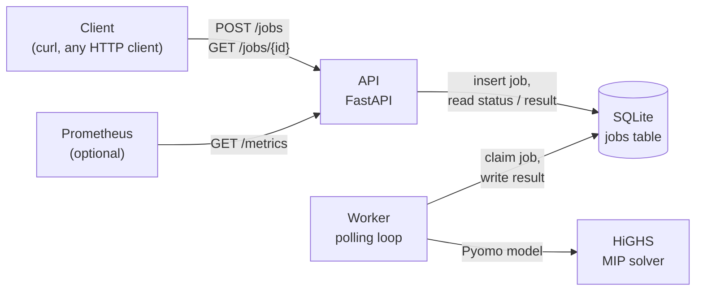
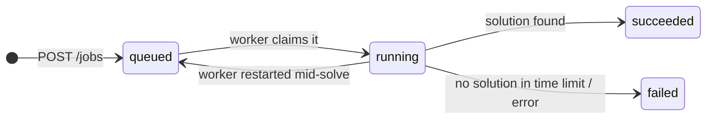

# Gate Assignment Optimizer

[](https://github.com/dogutez/gate-assignment-optimizer/actions/workflows/ci.yml)

Assigns a day of flights to airport gates with a Mixed-Integer Program (Pyomo + HiGHS) and
serves it as a REST API with background solve jobs (FastAPI, SQLite job store, separate worker).

On the largest test day (400 flights, 30 gates, up to 56 aircraft on the ground at once)
HiGHS proves optimality (gap 0.001%) in about 30 seconds, and every solution is re-checked
by an independent feasibility checker.

## The problem

Every flight needs a gate for the time it is on the ground. The schedule is fixed for one day:

- A flight occupies its gate from **arrival** until **departure + buffer** (default 15 min,
  for pushback and cleaning). Two flights whose occupation times overlap cannot share a gate.
- Aircraft are small, medium or large (`S` / `M` / `L`). A gate takes aircraft up to its
  `max_size`: an `L` gate also takes `S` and `M`, an `S` gate takes only `S`.
- Each gate has a **walking distance** to the terminal. Passengers should walk as little as
  possible, so full flights should get the close gates.
- If no gate is free, the flight parks on the **apron** (remote stand) and passengers are
  bussed. This is always possible but expensive: a fixed penalty plus a per-passenger cost.

Goal: give every flight one gate or the apron, minimizing total passenger walking
(passenger-meters) plus apron cost.

## Mathematical model

**Sets and parameters**

| Symbol | Meaning |
|---|---|
| $F$, $G$ | flights, gates |
| $K_i \subseteq G$ | gates compatible with flight $i$ (aircraft size $\le$ gate max size) |
| $p_i$ | passengers on flight $i$ |
| $d_k$ | walking distance of gate $k$ (m) |
| $s_i$, $e_i$ | arrival and departure of flight $i$ (minutes from midnight) |
| $b$ | buffer after departure (min) |
| $P$, $d_A$ | apron penalty per flight, apron distance per passenger (default $10^6$ and 1,500 m) |

**Variables**: $x_{ik} \in \{0,1\}$ for $i \in F$, $k \in K_i$ (flight $i$ at gate $k$), and
$a_i \in \{0,1\}$ (flight $i$ at the apron). Incompatible pairs get no variable at all.

```math
\begin{aligned}
\min \quad & \sum_{i \in F} \sum_{k \in K_i} p_i \, d_k \, x_{ik}
           \;+\; \sum_{i \in F} \left(P + p_i \, d_A\right) a_i \\
\text{s.t.} \quad & \sum_{k \in K_i} x_{ik} + a_i = 1 && \forall i \in F \\
& \sum_{i \in Q,\; k \in K_i} x_{ik} \le 1 && \forall Q \in \mathcal{Q},\; k \in G \\
& x_{ik},\, a_i \in \{0, 1\}
\end{aligned}
```

The first constraint gives every flight exactly one place. The second is the no-overlap
constraint. Flight $i$ occupies its gate on the interval $[s_i,\, e_i + b)$, and
$\mathcal{Q}$ is the set of groups of flights that are on the ground at the same moment:

```math
Q_j = \{\, i \in F : s_i \le s_j < e_i + b \,\} \qquad \text{(flights on the ground when } j \text{ arrives)}
```

keeping only groups with at least two flights that are not contained in a larger group.
All flights in $Q_j$ overlap each other, so at most one of them can use a gate. Two
overlapping intervals always both contain the later of their two arrival times, so every
conflicting pair is inside some $Q_j$ and the constraint set is complete.

The textbook alternative (`pairwise`, also implemented) writes one constraint per
conflicting pair and gate: $x_{ik} + x_{jk} \le 1$. The clique form is equivalent for
integer solutions but needs far fewer rows and has a tighter LP relaxation: with three
mutually overlapping flights, pairwise allows $x = \tfrac12$ for each of them, the clique
constraint does not.

**Why the apron cost has a per-passenger term**: with only the fixed penalty $P$, apron
passengers cost nothing, so the model sent the fullest flights to the apron to save their
walking. $p_i \, d_A$ makes a bussed passenger count like a 1,500 m walk.

## Architecture



A solve can take minutes, so the API does not solve anything. It validates the request,
stores it as a `queued` job and returns `202` with a `job_id` right away. A separate worker
process polls the table, claims the oldest queued job with one atomic
`UPDATE ... RETURNING` statement, solves it and writes the result back. The client polls
`GET /jobs/{id}` until the job is done.



- SQLite instead of a message broker: one file, no extra service, and the job history can
  be queried with SQL. WAL mode lets the API read while the worker writes.
- If the time limit is reached with a feasible solution, the job still succeeds with
  `solver_status: "feasible"` and the remaining `mip_gap`. If no solution was found, it fails
  with the reason in `error`.
- v1 runs a single worker: on start it puts jobs left in `running` back into the queue,
  which is only safe when no other worker is running.

## Quick start with Docker

```bash
git clone https://github.com/dogutez/gate-assignment-optimizer.git
cd gate-assignment-optimizer
docker compose up --build -d       # API on http://127.0.0.1:8000, plus one worker
```

Submit the large instance and poll until it is done (needs `python3` on the host to build
the request body):

```bash
API=http://127.0.0.1:8000

JOB=$(python3 -c "import json; print(json.dumps({'instance': json.load(open('data/instances/large.json')), 'options': {'time_limit_s': 120}}))" \
  | curl -s -X POST $API/jobs -H "Content-Type: application/json" -d @- \
  | python3 -c "import json, sys; print(json.load(sys.stdin)['job_id'])")

until curl -s $API/jobs/$JOB | grep -qE '"status":"(succeeded|failed)"'; do sleep 2; done

curl -s $API/jobs/$JOB            # status, objective, gap, timings
curl -s $API/jobs/$JOB/result     # assignments + KPIs
```

Job status after about 30 seconds:

```json
{
  "job_id": "3665af32e0d34d6ca820c2a9a231f1dc",
  "status": "succeeded",
  "instance_name": "large",
  "n_flights": 400,
  "n_gates": 30,
  "created_at": "2026-11-07T15:16:55.789215Z",
  "started_at": "2026-11-07T15:16:56.276797Z",
  "finished_at": "2026-11-07T15:17:28.844861Z",
  "solver_status": "optimal",
  "termination": "convergenceCriteriaSatisfied",
  "objective": 137413483.0,
  "mip_gap": 1.17e-05,
  "solve_time_s": 32.34,
  "error": null
}
```

Result (assignments shortened):

```json
{
  "job_id": "3665af32e0d34d6ca820c2a9a231f1dc",
  "assignments": [
    {"flight_id": "F001", "gate_id": "G12"},
    {"flight_id": "F002", "gate_id": "G02"},
    {"flight_id": "F003", "gate_id": "G06"}
  ],
  "kpis": {
    "n_flights": 400,
    "apron_count": 85,
    "total_walk_pax_m": 28179483.0,
    "avg_walk_per_pax_m": 586.19,
    "gate_utilization": 0.503
  }
}
```

Follow the JSON logs with `docker compose logs -f`. Stop everything with
`docker compose down` (add `-v` to delete the job database).

- `api` and `worker` run from the same image and share one SQLite file on the `jobs-data` volume.
- The port is published on `127.0.0.1` only; use `API_PORT=8010 docker compose up` if 8000 is taken.
- `docker stop` sends SIGTERM: the worker exits after its current job. If it is killed
  during a solve, the job is put back in the queue when the worker starts again.

## API

Interactive docs (Swagger UI): http://127.0.0.1:8000/docs

| Method | Path | Purpose |
|---|---|---|
| `GET` | `/health` | Liveness check |
| `POST` | `/jobs` | Submit `{"instance": ..., "options": {"time_limit_s": 60, "mip_gap": 0.0001, "solver": "highs", "threads": null}}`; returns `202` with `job_id` and a `Location` header |
| `GET` | `/jobs/{job_id}` | Status (`queued` / `running` / `succeeded` / `failed`), timestamps, solver status, objective, gap |
| `GET` | `/jobs/{job_id}/result` | Assignments (`flight_id` → `gate_id` or `APRON`) and KPIs; `409` until the job has succeeded |
| `GET` | `/jobs?limit=20` | Most recent jobs |
| `GET` | `/metrics` | Prometheus metrics (see [Monitoring](#monitoring)) |

An instance looks like this (all times in minutes from midnight; `options` is optional):

```json
{
  "instance": {
    "name": "tiny",
    "buffer": 15,
    "flights": [
      {"id": "F1", "arrival": 480, "departure": 540, "aircraft_size": "M", "pax": 150},
      {"id": "F2", "arrival": 500, "departure": 600, "aircraft_size": "L", "pax": 300}
    ],
    "gates": [
      {"id": "G1", "max_size": "L", "walk_dist": 120},
      {"id": "G2", "max_size": "M", "walk_dist": 200}
    ]
  },
  "options": {"time_limit_s": 10}
}
```

`solver` is `highs` (default), `gurobi` or `cplex`. Gurobi and CPLEX are optional
(`uv sync --extra solvers`, not in the Docker image) and need a license above their free
size limits; if a solver cannot run, the job fails with the reason in `error`.

Invalid input (departure before arrival, duplicate ids, unknown fields, a gate called
`APRON`, more than 2,000 flights, ...) is rejected with `422` before it reaches the queue.

KPIs: `apron_count`, `total_walk_pax_m` (passenger-meters at gates), `avg_walk_per_pax_m`,
and `gate_utilization` (minutes gates are occupied / (day length × number of gates)).

## Results

Three synthetic instances come with the repo (`data/generate.py`, fixed seeds). Arrivals
follow a morning and an evening peak; the aircraft mix is 30% S, 50% M, 20% L.

| Instance | Flights | Gates | Peak flights on ground |
|---|---|---|---|
| small | 20 | 10 | 4 |
| medium | 150 | 20 | 20 |
| large | 400 | 30 | 56 |

The large instance is deliberately congested: at peak times there are more aircraft than
gates, so some flights must go to the apron.

```bash
uv run python -m scripts.benchmark --repeat 3
```

Environment: HiGHS 1.15.1, Pyomo 6.10.1, Python 3.12.16, AMD Ryzen 7 3700U (laptop CPU),
time limit 120 s, median of 3 runs.

| Instance | Flights | Gates | Formulation | Variables | Constraints | Build (s) | Solve (s) | Status | MIP gap | Apron | Checker |
|---|---|---|---|---|---|---|---|---|---|---|---|
| small | 20 | 10 | clique | 120 | 62 | 0.00 | 0.02 | optimal | 0.000% | 0 | OK |
| small | 20 | 10 | pairwise | 120 | 78 | 0.00 | 0.02 | optimal | 0.000% | 0 | OK |
| medium | 150 | 20 | clique | 2,262 | 1,358 | 0.07 | 0.18 | optimal | 0.000% | 5 | OK |
| medium | 150 | 20 | pairwise | 2,262 | 16,340 | 0.16 | 0.63 | optimal | 0.000% | 5 | OK |
| large | 400 | 30 | clique | 8,476 | 4,580 | 0.23 | 29.68 | optimal | 0.001% | 85 | OK |
| large | 400 | 30 | pairwise | 8,476 | 193,688 | 1.79 | 38.20 | optimal | 0.002% | 85 | OK |

- Both formulations reach the same optimum. On `large` the clique form needs 42x fewer
  constraints, builds 8x faster and solves about 20% faster.
- Status `optimal` means within the requested relative gap (default 0.01%).
- **Objective scaling matters.** The objective is about $10^8$ passenger-meters. Passed to
  HiGHS unscaled, the solver stayed at the root node and still had a 14% gap on `large`
  after 60 s; symmetry, cut and presolve options did not help. Scaled to passenger-kilometers
  it is optimal in about 30 s. Results are reported in passenger-meters again.
- On `large`, wide-bodies are over-represented at the apron (33 of 85 apron flights, while
  only 22% of all flights are L): 87 L flights (avg. 89 min on ground) share 8 L-capable gates.
  That is a capacity limit of the gate mix, not a model artifact.

### What the MIP adds over a heuristic

`app/heuristic.py` builds a plan the way a planner might, then improves it:

- **Greedy**: flights in arrival order, each to the smallest free gate it fits (keeps
  wide-body gates for wide-bodies), nearest first; apron if nothing is free.
- **Local search**: starting from the greedy plan, move a flight to another place or swap
  two flights whenever that is feasible and lowers the cost, until no such move is left.

```bash
uv run python -m scripts.baseline
```

| Instance | Method | Cost (pax·m) | Above MIP | Apron | Avg. walk (m) | Time (s) | Checker |
|---|---|---|---|---|---|---|---|
| small | greedy | 1,209,816 | 0.8% | 0 | 309 | 0.00 | OK |
| small | greedy + local search | 1,200,372 | 0.0% | 0 | 306 | 0.00 | OK |
| small | MIP (optimal) | 1,200,372 | 0.0% | 0 | 306 | 0.13 | OK |
| medium | greedy | 14,888,251 | 5.2% | 5 | 406 | 0.00 | OK |
| medium | greedy + local search | 14,470,116 | 2.2% | 5 | 393 | 0.07 | OK |
| medium | MIP (optimal) | 14,158,944 | 0.0% | 5 | 380 | 0.20 | OK |
| large | greedy | 145,986,780 | 6.2% | 90 | 604 | 0.00 | OK |
| large | greedy + local search | 142,646,420 | 3.8% | 89 | 597 | 0.85 | OK |
| large | MIP (optimal) | 137,413,483 | 0.0% | 85 | 586 | 29.79 | OK |

- A good rule gets within a few percent. On `large` the MIP still saves 5.2 million
  passenger-meters over greedy + local search and puts 4 fewer flights on the apron, and
  it proves that no better plan exists. A heuristic cannot say how far from the optimum it is.
- The rule matters: "fullest flight first" was 29% above the optimum on `large`
  (121 apron flights), "arrival order, nearest gate" 16%.
- The heuristic answers in under a second, which makes it useful for a fast re-plan
  during the day, or as a fallback if the MIP hits its time limit.

## Verification

- `app/checker.py` checks a solution **without importing the model code**: every flight is
  assigned exactly once, every aircraft fits its gate, consecutive flights at a gate are at
  least `buffer` minutes apart, and the cost recomputed from scratch equals the solver's
  objective. The benchmark runs it on every solution (the "Checker" column).
- 61 pytest tests: hand-made cases with known answers (nearest gate, apron when gates run
  out, buffer boundary at exactly 15 minutes, fuller flight gets the closer gate), both
  formulations giving the same optimum, the heuristics staying feasible and never beating
  the MIP, the checker catching deliberately broken
  assignments, the time-limit path, input validation, the job lifecycle through the API,
  worker failure handling, logging and the metrics output.
- CI (GitHub Actions) runs `ruff check`, `ruff format --check`, `pytest` and `docker build`
  on every push and pull request, with the exact dependency versions from `uv.lock`.

Solve one instance from the command line and print the gate schedule:

```bash
uv run python -m scripts.solve data/instances/medium.json --show
```

## Logging

API and worker write one JSON object per line to stdout (uvicorn's own lines included).
Every line written while a job is handled carries its `job_id`, also lines from the model
code, which knows nothing about jobs: the worker stores the id in a `ContextVar` and a log
filter adds it to each record. Level is set with `LOG_LEVEL` (default `INFO`).

```json
{"time": "...", "level": "INFO", "logger": "app.model", "event": "model built", "formulation": "clique", "n_variables": 2262, "n_constraints": 1358, "build_time_s": 0.059, "job_id": "1403136465a04a318758bd4761f8176c"}
{"time": "...", "level": "INFO", "logger": "app.model", "event": "solve finished", "status": "optimal", "termination": "convergenceCriteriaSatisfied", "objective": 14158944.0, "mip_gap": 0.0, "solve_time_s": 0.288, "time_limit_s": 60.0, "job_id": "1403136465a04a318758bd4761f8176c"}
```

Events: `job submitted`, `job started`, `model built`, `solve finished`, `job succeeded`,
`job failed` (with `error_type`, `error` and `traceback`).

## Monitoring

`GET /metrics` serves metrics in the Prometheus text format, written by hand in
`app/metrics.py` (no client library needed):

| Metric | Type | Meaning |
|---|---|---|
| `gate_optimizer_jobs{status}` | gauge | Jobs currently queued / running / succeeded / failed |
| `gate_optimizer_oldest_queued_job_age_seconds` | gauge | How long the oldest queued job has been waiting |
| `gate_optimizer_solve_seconds` | summary | Count and total solver time of succeeded jobs |
| `gate_optimizer_http_requests_total{method,path,code}` | counter | API requests, by route template (`/jobs/{job_id}`, not every id) |

Job metrics are read from the SQLite table when Prometheus scrapes, so they cover the
worker too, although the worker has no HTTP port. A stopped worker shows up as a queue
that keeps getting older.

Start the stack with Prometheus:

```bash
docker compose --profile monitoring up --build -d
```

Prometheus runs on http://127.0.0.1:9090 (`PROMETHEUS_PORT` to change it), scrapes the API
every 15 s and evaluates three alert rules from `monitoring/alerts.yml`:

| Alert | Fires when |
|---|---|
| `ApiDown` | `/metrics` cannot be scraped for 1 minute |
| `JobQueueStuck` | a job has been queued for more than 10 minutes (worker down or overloaded) |
| `JobsFailing` | a job failed in the last 15 minutes |

Example queries: `gate_optimizer_jobs`, average solve time
`rate(gate_optimizer_solve_seconds_sum[1h]) / rate(gate_optimizer_solve_seconds_count[1h])`.
CI checks the config and rules with `promtool`.

## Local development

Requires [uv](https://docs.astral.sh/uv/) (it installs Python 3.12 if needed).

```bash
uv sync                                   # create .venv with all dependencies
uv run pytest                             # tests (~6 s)
uv run ruff check . && uv run ruff format --check .
uv run python -m data.generate            # regenerate data/instances/*.json

uv run python -m app.api --port 8000      # terminal 1: API on 127.0.0.1:8000
uv run python -m app.worker               # terminal 2: worker
```

Both processes use `JOBS_DB_PATH` (default `jobs.db`).

## Project layout

| Path | What it does |
|---|---|
| `app/schemas.py` | Pydantic models: instance format and API request/response; the single data contract |
| `app/model.py` | Pyomo model (both formulations), HiGHS solve, KPIs |
| `app/heuristic.py` | Greedy + local search baseline |
| `app/checker.py` | Independent solution checker and cost recomputation |
| `app/jobs.py` | SQLite job store: create, claim, finish, requeue |
| `app/worker.py` | Polling worker with graceful shutdown on SIGTERM |
| `app/api.py` | FastAPI endpoints |
| `app/logging_conf.py` | JSON log formatter and `job_id` context |
| `app/metrics.py` | Prometheus metrics text for `/metrics` |
| `data/generate.py` | Synthetic instance generator; output in `data/instances/` |
| `scripts/solve.py`, `scripts/benchmark.py`, `scripts/baseline.py` | Command-line solve, formulation benchmark, heuristic vs MIP |
| `tests/` | pytest suite |
| `Dockerfile`, `docker-compose.yml` | One image, two services (`api`, `worker`) |
| `monitoring/` | Prometheus scrape config and alert rules |
| `.github/workflows/ci.yml` | Lint, test and image build on every push |

## Assumptions and limits

- One day, deterministic schedule: delays are not modelled beyond the fixed buffer.
- Gate compatibility depends on aircraft size only; neighbouring gates do not block each other.
- Each gate has one walking distance; transfer passengers are not modelled separately.
- Instances are synthetic. The input format is plain JSON, so a real schedule can be
  submitted the same way.

## Possible extensions

- **More workers**: claiming is already atomic, so several workers can run at once. What is
  missing is a lease/heartbeat to requeue jobs of a crashed worker instead of the
  requeue-on-start rule; or move the queue to Redis + RQ.
- **Richer objective**: tow penalties for long stays (move the aircraft to a remote stand
  in between), airline gate preferences, adjacency rules for wide-bodies.
- **Robustness**: penalize small gaps between consecutive flights at a gate so that a
  delay does not cascade; re-optimize during the day with a warm start from the current plan.
- **Heuristic + MIP together**: offer the heuristic as a `method` option in the API, or pass
  its plan to the solver as a starting solution.
- **Solver comparison**: the same model in GAMS to compare solvers.
- **Dashboards and notifications**: a Grafana dashboard on top of Prometheus, and
  Alertmanager to send the alerts to mail or Slack.
- **Visual output**: a Gantt chart of the gate schedule as a PNG endpoint.

## License

[MIT](LICENSE)
